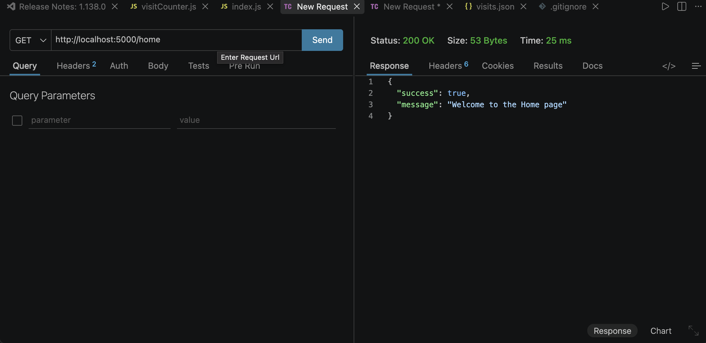
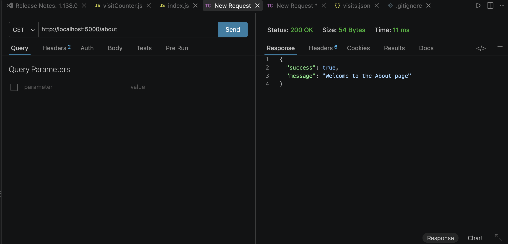
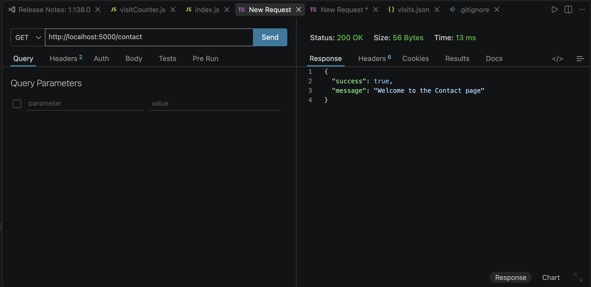
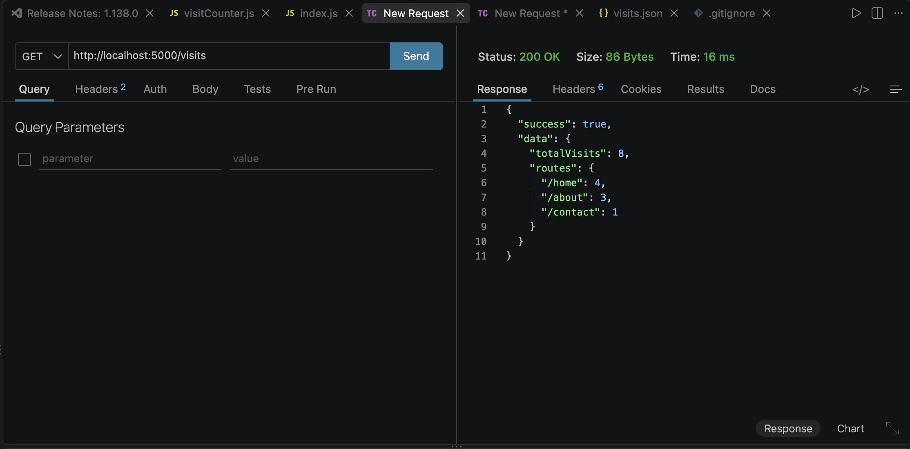

# Express Middleware Visit Counter

A Node.js and Express mini-project that tracks page visits using custom middleware and the `fs` module, persisting data to a JSON file without a database.

## Steps to Run the Project
1. Open a terminal in the project folder.
2. Run `npm install` to install Express.
3. Run `node index.js` to start the server.
4. Open a browser and visit `http://localhost:5000/home`, `/about`, or `/contact`.
5. Visit `http://localhost:5000/visits` to view the visit statistics.

## Testing Screenshots

### 1. Home Route (/home)

### 2. About Route (/about)

### 3. Contact Route (/contact)

### 4. Visit Statistics (/visits)
